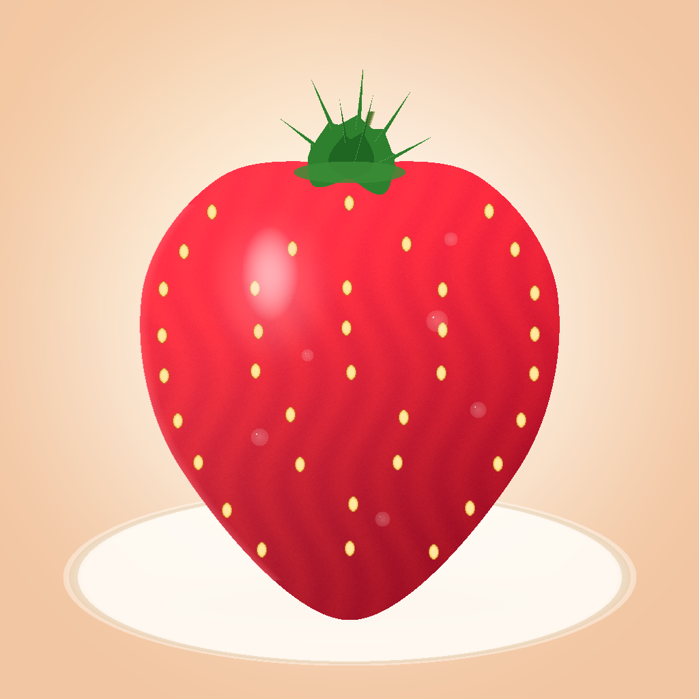

# The picture that tastes of one ingredient



A single ripe strawberry — glossy, seeded, dewy, on a plate — drawn entirely
by code. `main.ts` (Node 22, stdlib only) rasterizes the berry procedurally
(Catmull-Rom body, gradient shading, golden achenes, green calyx, dew drops)
and writes `/output/entry.png` (1024×1024, ≤ 1 MiB) with a hand-rolled PNG
encoder.

## Run

```sh
node main.ts   # writes /output/entry.png (deterministic, byte-identical every run)
```

## make.fun

Entry for [the-picture-that-tastes-of-one-20261122-2047](https://make.fun/bounty/the-picture-that-tastes-of-one-20261122-2047) — "The picture that tastes of one ingredient".
